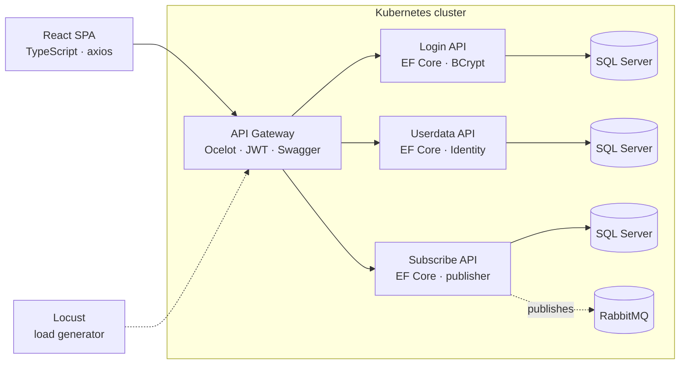

Streaming Platform — .NET 8 Microservices
A streaming service built as a distributed system: four independent .NET 8 services behind an
API gateway, each owning its own database, communicating asynchronously over RabbitMQ, deployed
to Kubernetes with horizontal autoscaling and tested under load.
Originally an academic project. Built the way it would be run in production.
---
Architecture

Design decisions
Authentication happens once, at the edge. The gateway validates the JWT and routes onward,
so no downstream service duplicates auth logic. A service can trust the identity it receives.
Database per service. Each service owns its schema. No service reads another's tables,
which means they can be deployed and migrated independently.
Asynchronous where it matters. Subscribe publishes events to RabbitMQ rather than calling
synchronously. A slow or unavailable consumer cannot cascade back into the request path.
Autoscaling is configured, not assumed. Three HorizontalPodAutoscalers cover the gateway,
login and userdata deployments, so the scaling behaviour is observable under Locust load rather
than theoretical.
---
Services
Service	Responsibility	Notable dependencies
`ApiGateWay`	Routing, JWT validation, Swagger aggregation	Ocelot, JwtBearer
`Login`	Authentication, credential hashing, token issuing	EF Core, BCrypt.Net, AutoMapper
`Userdata`	User profiles and identity data	EF Core, ASP.NET Identity
`Subscribe`	Subscription lifecycle, event publishing	EF Core, RabbitMQ.Client
`netflixclone`	Frontend client	React, react-router-dom, axios
---
Infrastructure
Kubernetes — 19 Deployments, 15 Services, 3 HorizontalPodAutoscalers, PersistentVolumeClaims
for the databases, Secrets for credentials, and a ConfigMap carrying the Locust scenario.
Manifests live in `/Kubernetes`.
Load testing — Locust runs inside the cluster and drives traffic at the gateway, which is how
the autoscaler thresholds were validated. See `/Locust`.
Cost control — `StopElasticPoolFunction` is an Azure Function that shuts down the SQL elastic
pool when the environment is idle. Cloud bills for student projects get expensive quickly; this
was cheaper than remembering to turn things off.
---
CI
Every push runs `.github/workflows/main.yml`:
Restore and build each service independently
Snyk — scans dependencies for known vulnerabilities
SonarCloud — static analysis and code quality gate
Broken or vulnerable code does not reach the main branch.
---
Running locally
```bash
# databases, message broker and services
docker compose -f Kubernetes/docker-compose.yml up -d

# frontend
cd netflixclone
npm install
npm start
```
The gateway exposes Swagger once running. Configure connection strings and the JWT signing key
via environment variables or user secrets — do not commit them.
Deploying to Kubernetes
```bash
kubectl apply -f Kubernetes/secret.yaml
kubectl apply -f Kubernetes/persistentvolumeclaim.yaml
kubectl apply -f Kubernetes/
kubectl get hpa
```
---
Status
Feature-complete as a demonstration of distributed architecture. Not a production service, and
not affiliated with any streaming company — the domain was chosen because subscriptions,
profiles and authentication are a familiar shape for modelling service boundaries.
